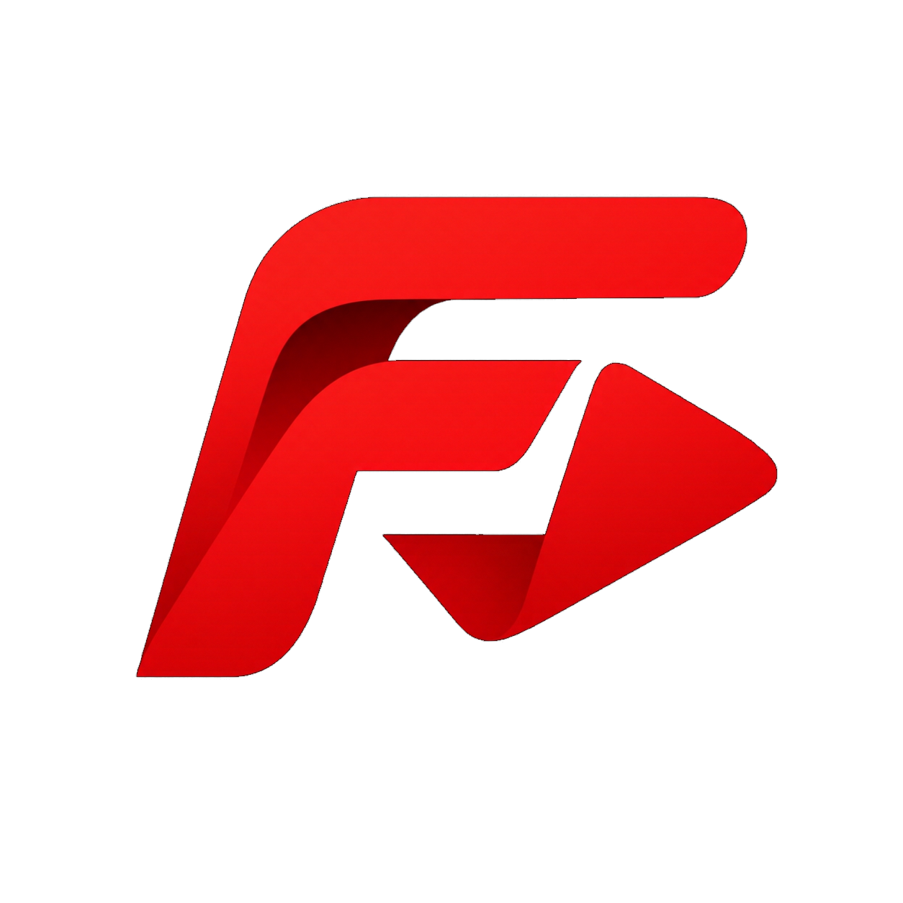

<!-- Animated Header with Professional Waving Red Theme -->

<!-- Logo -->

 

<!-- High-Visibility Red Theme Typing Animation -->

 

<!-- Tech Badges -->

  

**FAM Zone** is a premium, all-in-one streaming aggregator dashboard - a sleek, lightning-fast hub that unifies **live football**, **movies**, **TV shows**, and **anime** into one beautiful dark-themed interface. Never miss a goal, an episode, or your place in a story again.

<!-- Red Gradient Separator (Fixed Blue Lines) -->

 

## ⚡ Highlights

<table>
<tr>
<td width="50%" align="center">

### 🏟️ Live Football

Real-time scores, live stats, team lineups & multi-source streaming across **30 competitions** worldwide

</td>
<td width="50%" align="center">

### 🎬 Movies & TV

Massive TMDB-powered library streamed through curated embed providers, with position history on the primary source

</td>
</tr>
<tr>
<td width="50%" align="center">

### 🎌 Anime Haven

AniList-synced library with airing schedules, genre filters, episode tracking & multiple sources

</td>
<td width="50%" align="center">

### 🤖 FAM AI & Story Hub

Gemini-powered watchlist summaries and recaps, plus AI-assisted discovery across movies, TV and anime

</td>
</tr>
<tr>
<td width="50%" align="center">

### 🎉 Watch Parties

Synchronized media playback and countdowns to watch together seamlessly across devices

</td>
<td width="50%" align="center">

### 📱 PWA & Mobile

Install as a native-like app on any device with a fully responsive, premium dark interface

</td>
</tr>
</table>

<!-- Red Gradient Separator -->

 

## 🚀 Features

<b>🤖 FAM AI & Story Hub</b> - <i>Reconstruct your memories</i>

 

| Feature                          | Description                                                                                  |
| :------------------------------- | :------------------------------------------------------------------------------------------- |
| 📚 **Story Hub (The Librarian)** | Get contextual recaps of past seasons or prequel movies before starting a new one.           |
| 🧠 **Watchlist AI Summaries**    | Persistent background analysis of your watchlist offering smart status reports and insights. |
| 🔍 **Discovery AI**              | Recommends modern and relevant shows using recency signals and your "Recently Watched" era.  |
| 🔔 **Airing Alerts**             | Automatic highlights for shows from your watchlist airing new episodes today.                |

<b>⚽ Football Hub</b> - <i>Never miss a match</i>

 

| Feature                       | Description                                                              |
| :---------------------------- | :----------------------------------------------------------------------- |
| 🔴 **Live Match Tracking**    | Real-time scores with auto-refresh for ongoing matches                   |
| 📡 **Multi-Source Streaming** | Priority-ranked source tiers with automatic fallback                     |
| 📊 **Match Statistics**       | Possession, shots, corners, fouls - all live                             |
| 👥 **Team Lineups**           | Full formation visualization with player details                         |
| 🌍 **30 Competitions**        | Premier League, La Liga, Bundesliga, Serie A, Champions League, and more |
| ⏱️ **Match Countdown**        | Countdown timers for upcoming fixtures                                   |

<b>🎬 Movies & TV Shows</b> - <i>Your massive cinematic library</i>

 

| Feature                   | Description                                                            |
| :------------------------ | :--------------------------------------------------------------------- |
| 🎞️ **Extensive Library**  | Browse thousands of titles via TMDB integration                        |
| ▶️ **Provider Players**   | Ten curated embed sources; quality and subtitles come from the provider |
| ⏪ **Resume Playback**    | Nxsha position history on the Hope source; other sources start fresh   |
| 📋 **Watchlist**          | Personal list with statuses: Watching, Completed, On Hold, Dropped, Plan to Watch, Rewatching |
| 🔥 **Trending & Popular** | Curated rows of what's hot right now                                   |
| 🎠 **Hero Carousels**     | Cinematic featured content banners                                     |

<b>🎌 Anime Haven</b> - <i>Sync your otaku life</i>

 

| Feature                      | Description                                       |
| :--------------------------- | :------------------------------------------------ |
| 🔗 **AniList Integration**   | Sync your anime list, track progress, OAuth login |
| 📅 **Airing Schedule**       | Weekly calendar of upcoming episodes              |
| 🏷️ **Advanced Filters**      | Search by genre, tags, popularity, and score      |
| 🎵 **Multi-Source Playback** | Multiple streaming providers with quality options |
| ✅ **Episode Tracking**      | Automatic watched episode progress                |
| 🗺️ **Browse & Discover**     | Curated galleries and trending anime              |

<b>🛠️ Core Experience</b> - <i>The universal backbone</i>

 

| Feature                   | Description                                           |
| :------------------------ | :---------------------------------------------------- |
| 🔍 **Global Search**      | <kbd>⌘ K</kbd> / <kbd>Ctrl K</kbd> instant search across anime, movies and TV |
| 🎉 **Watch Parties**      | Invite friends and synchronize playback automatically |
| 🕐 **Recently Watched**   | Quick-access row for your last-viewed media           |
| 📜 **Watch History**      | Full history with resumable playback positions        |
| 📱 **PWA Support**        | Install as a native-like app on any device            |
| 💻 **Responsive Design**  | Optimized for mobile, tablet, and desktop             |
| 🌙 **Dark Premium Theme** | Sleek dark aesthetic with signature red accents       |

<!-- Red Gradient Separator -->

 

## 🧰 Tech Stack

 

<!-- Tech Icons Row -->

&nbsp;&nbsp;
&nbsp;&nbsp;
&nbsp;&nbsp;
&nbsp;&nbsp;
&nbsp;&nbsp;
&nbsp;&nbsp;
&nbsp;&nbsp;

  

| Layer             | Technology                                                                                                               |
| :---------------- | :----------------------------------------------------------------------------------------------------------------------- |
| **Framework**     | [Next.js 16](https://nextjs.org/) - App Router with Server Components                                                    |
| **Language**      | [TypeScript 5.9](https://www.typescriptlang.org/) - End-to-end type safety                                               |
| **UI**            | [React 19](https://react.dev/) + [Tailwind CSS 3](https://tailwindcss.com/)                                              |
| **Database**      | [Supabase](https://supabase.com/) - PostgreSQL with Realtime subscriptions                                               |
| **AI Engine**     | Next.js route handlers: Google Gemini by default, or any OpenAI-compatible endpoint with multi-key rotation              |
| **Video**         | [Video.js 8](https://videojs.com/) for football + [HLS.js](https://github.com/video-dev/hls.js/) for anime               |
| **Icons**         | [Lucide React](https://lucide.dev/)                                                                                      |
| **Notifications** | [Sonner](https://sonner.emilkowal.dev/)                                                                                  |
| **State**         | [Zustand](https://zustand-demo.pmnd.rs/) local state + Supabase Realtime broadcast/presence (Watch Parties)              |
| **Caching**       | [LRU-Cache](https://github.com/isaacs/node-lru-cache) with configurable TTLs                                             |
| **Analytics**     | [Vercel Analytics](https://vercel.com/analytics)                                                                         |
| **APIs**          | TMDB · AniList GraphQL · Jikan · ESPN                                                                                    |
| **Deployment**    | Vercel                                                                                                                   |

<!-- Red Gradient Separator -->

 

## 🏆 Supported Football Leagues

 

|    🇬🇧 England    |   🇪🇸 Spain   | 🇩🇪 Germany |   🇮🇹 Italy   |    🇫🇷 France    |
| :--------------: | :----------: | :--------: | :----------: | :-------------: |
|  Premier League  |   La Liga    | Bundesliga |   Serie A    |     Ligue 1     |
|   Championship   | Copa del Rey | DFB-Pokal  | Coppa Italia | Coupe de France |
| FA Cup · EFL Cup |              |            |              |                 |

| 🇺🇸 USA |     🏴󠁧󠁢󠁳󠁣󠁴󠁿 Scotland      |  🇵🇹 Portugal  | 🇳🇱 Netherlands | 🇹🇷 Turkey |
| :----: | :------------------: | :-----------: | :------------: | :-------: |
|  MLS   | Scottish Premiership | Liga Portugal |   Eredivisie   | Süper Lig |

|  🇧🇷 Brazil  |   🇦🇷 Argentina   | 🇲🇽 Mexico |        🌍 International         | 🏆 European Cups |
| :---------: | :--------------: | :-------: | :-----------------------------: | :--------------: |
| Brasileirão | Liga Profesional |  Liga MX  | World Cup · Euro · Copa América · UEFA Nations League · CONCACAF Gold Cup · AFCON · AFC Asian Cup | UCL · UEL · UECL |

<!-- Red Gradient Separator -->

 

## 🔐 Security

FAM Zone is built with a focus on security and performance, featuring:

> 🛡️ **HSTS** - Strict Transport Security for encrypted connections
>
> 🛡️ **X-Frame-Options** - Industry-standard Clickjacking protection
>
> 🛡️ **X-Content-Type-Options** - Robust MIME-type sniffing prevention
>
> 🛡️ **Referrer-Policy** - Privacy-focused origin handling
>
> 🛡️ **Permissions-Policy** - Fine-grained hardware access control

 

## 📄 License & Contributions

This project is not open source: no licence is granted and no LICENSE file is included. An MIT licence is planned for a future release.

 

<!-- GitHub Stats & Streak (Red Themed / Neutral Background) -->

  
  

  

<!-- Red Gradient Footer Wave (Matching Top) -->

**Built with ❤️ by [Timeswantstocode](https://github.com/Timeswantstocode)**

_FAM & FAM Zone - Where every match, movie & anime lives under one roof._

